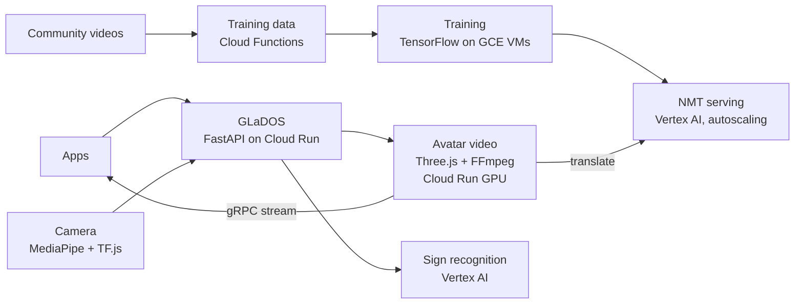

  

  

  

## Some things I've built in the last 5 years

| Project | What it does | Proof | Stack |
|---|---|---|---|
| **CloudCan** | AI support analyst in Slack: reads logs, metrics, databases and code, then posts the diagnosis | **1,900+** investigations in 6 months |  |
| **Sign-language avatar** | Text in, an avatar signing it out, rendered live on a cloud GPU | **60 fps**, real time |  |
| **NMT pipeline** | Community videos to a deployed translation model, fully automated | **3** sign languages |  |
| **GLaDOS** | One API for sign recognition, translation and the avatar video | **348** commits, sole author |  |
| **Mutano** | Marketing banners that build themselves with computer vision | Promo rollouts: **days** to **minutes** |  |

How the sign-language system fits together

## Let's talk

  

